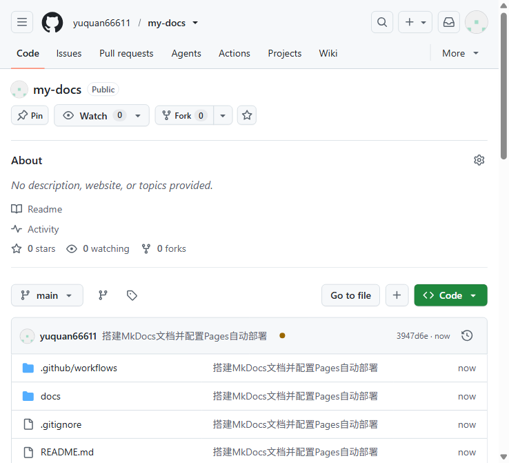
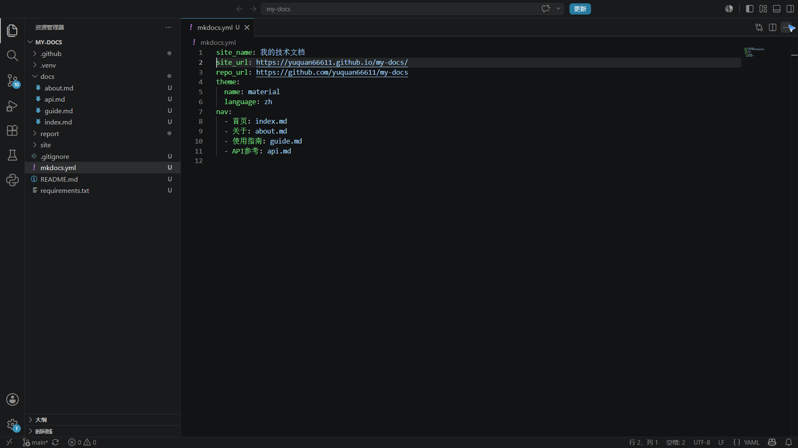
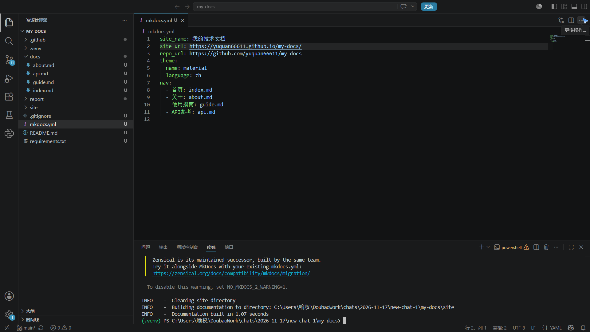
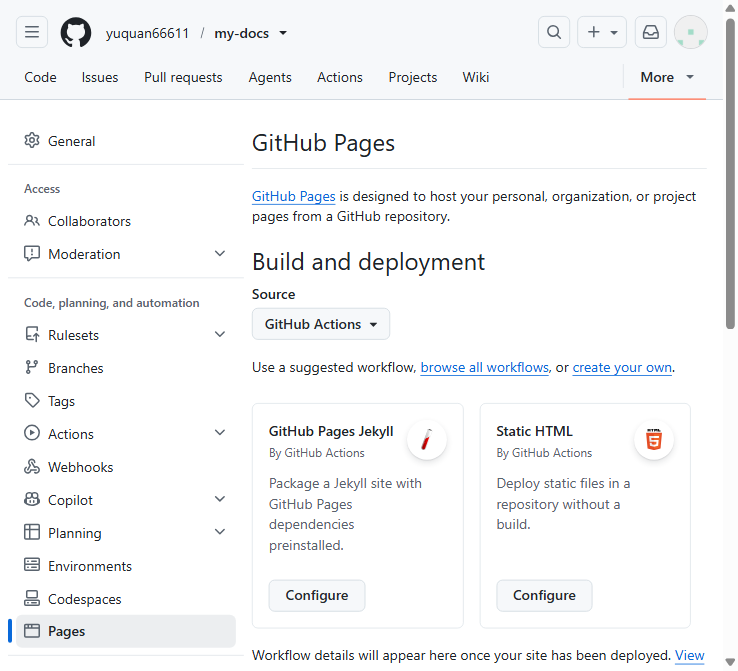
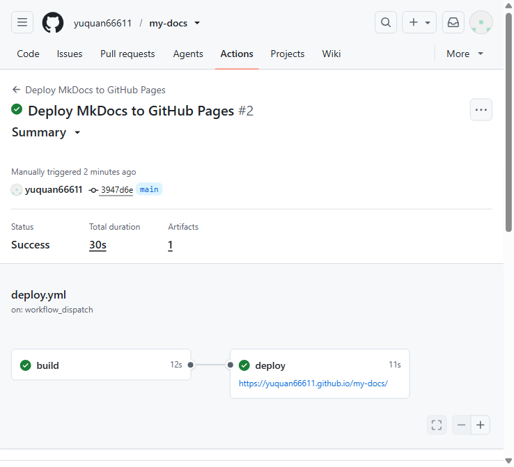
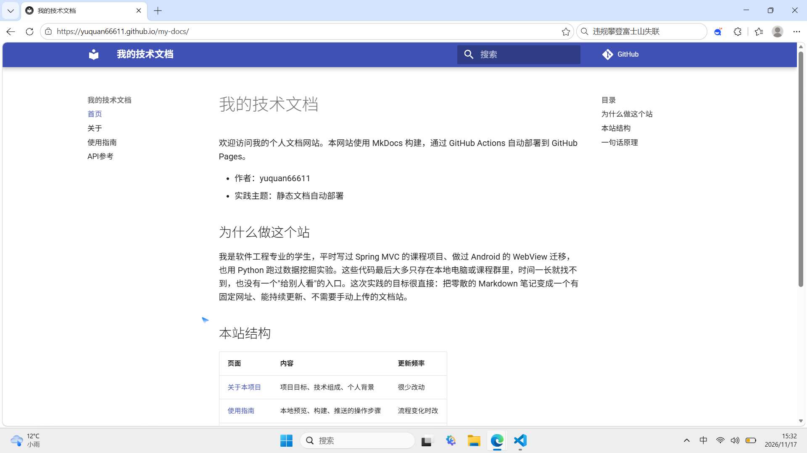
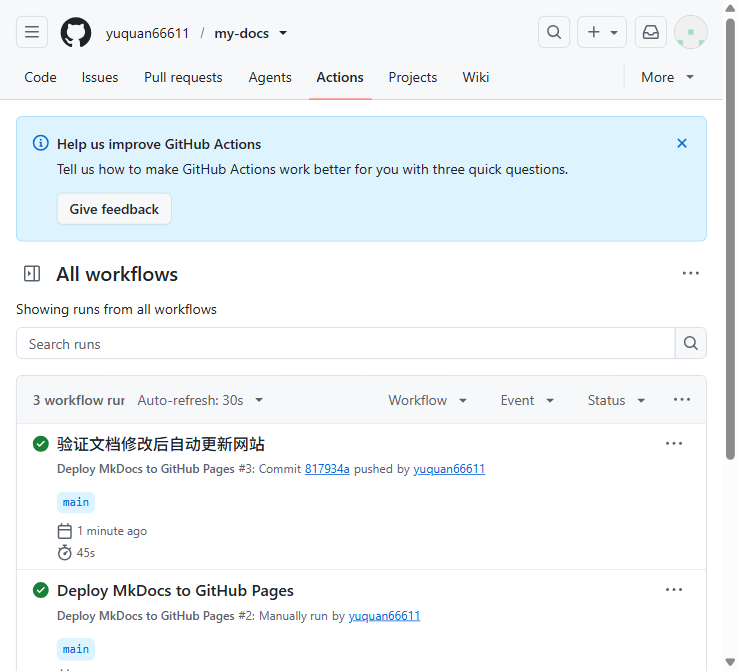
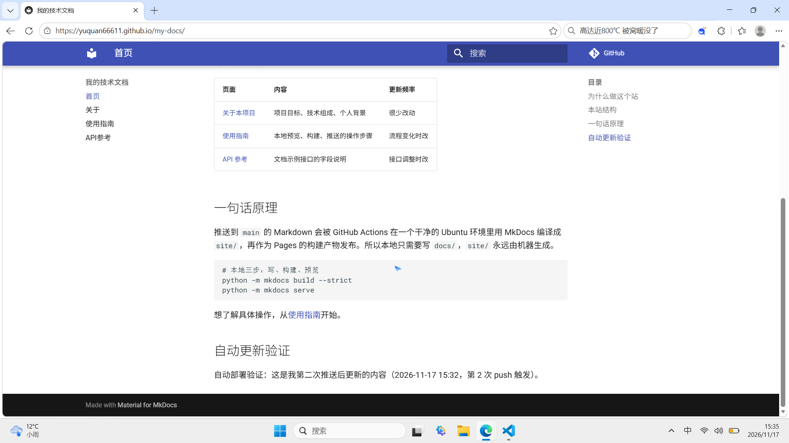
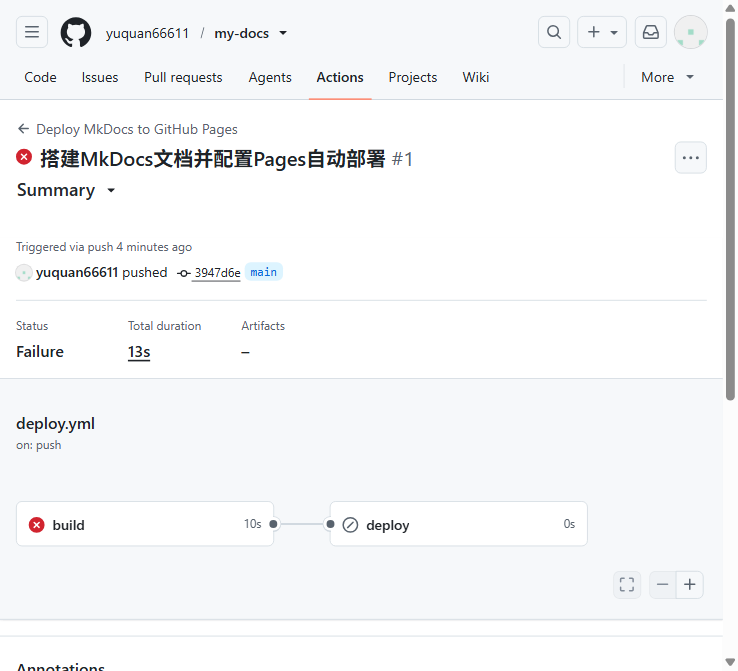

# 实践项目2：个人实验报告

## 1. 基本信息

- GitHub 登录名：yuquan66611
- 姓名拼音：yuquan（作业 Issue 标题使用）
- 个人仓库地址：https://github.com/yuquan66611/my-docs
- 最终网站地址：https://yuquan66611.github.io/my-docs/
- 关键提交：`3947d6e`（首次搭建并推送）、`817934a`（第二次推送验证自动更新）
- 关键运行：[运行 #2（首次部署成功）](https://github.com/yuquan66611/my-docs/actions/runs/44038695589)、[运行 #3（第二次 push 自动触发）](https://github.com/yuquan66611/my-docs/actions/runs/44039625638)

## 2. 实践过程与关键截图

### 2.1 仓库创建

**做了什么**：在本人的 GitHub 账号 `yuquan66611` 下新建仓库 `my-docs`，可见性选择 Public，不初始化 README（保持空仓库，方便本地直接 `git push` 建立 `main`）。随后在本地执行 `git clone https://github.com/yuquan66611/my-docs.git`，确认默认分支为 `main`。

**为什么这样做**：作业要求仓库公开、默认分支为 `main`，因为工作流的触发条件是 `push` 到 `main`。空仓库的好处是第一次提交就是完整的项目结构，不需要处理"远程 README 与本地文件冲突"这种额外合并。

**结果**：仓库创建成功，克隆后 `git branch --show-current` 输出 `main`。



### 2.2 项目结构与 MkDocs 配置

**做了什么**：在仓库根目录建立如下结构，四页文档放在 `docs/`，作业报告放在 `report/`。

```text
my-docs/
├── .github/workflows/deploy.yml
├── docs/{index,about,guide,api}.md
├── report/{README.md,images/}
├── mkdocs.yml
├── requirements.txt
├── .gitignore
└── README.md
```



**`docs/` 的作用**：存放网站的全部源内容，只有 `.md` 文件，是唯一需要手写的部分。四页中首页放站点概览和目录跳转，关于页放技术组成表与本人背景，指南页放操作流程与命令，API 页放接口示例，每页都有表格或代码块，并且页面之间互相链接。

**`nav` 的作用**：`mkdocs.yml` 的 `nav` 决定左侧导航的标题与顺序，它的路径**相对于 `docs/`**，所以写 `index.md` 而不是 `docs/index.md`。写成后者时 `--strict` 构建会直接报文件不存在。

**`site/` 的作用**：构建产物目录，由 `mkdocs build` 生成，包含 HTML、CSS、搜索索引等。它已经在 `.gitignore` 中忽略，因为它是 `docs/` 的可再生副本——每次构建内容都一致，提交它只会让仓库体积膨胀并制造无意义的差异。

### 2.3 本地构建或预览

**做了什么**：创建虚拟环境并安装依赖，先 `mkdocs build --strict` 做严格构建，再 `mkdocs serve` 起本地服务逐个页面检查。

```bash
python -m venv .venv
python -m pip install -r requirements.txt
python -m mkdocs build --strict
python -m mkdocs serve          # 浏览器打开 http://127.0.0.1:8000/my-docs/
```

本地实际安装版本：MkDocs 1.6.1、mkdocs-material 9.8.1。

**为什么这样做**：工作流里执行的就是 `mkdocs build --strict`，本地先跑一遍等价命令，可以把"断链、缺页、导航路径写错"这类问题在推送前拦住。不加 `--strict` 时这些只是警告，构建照旧成功，推上去就会在 Actions 里变成红色失败。

**结果**：严格构建通过，`Documentation built in 1.07 seconds`，`site/` 下生成 `index.html`、`about/`、`guide/`、`api/`、`assets/`、`404.html`、`sitemap.xml`。本地预览也正常。




**检查了哪些内容**：四个页面依次打开，确认左侧导航四项都能点击、表格正常渲染（关于页技术组成表、首页结构表、API 页参数表）、代码块有语法高亮、首页指向其余三页的链接可跳转、页面标题显示为"我的技术文档 / 关于 / 使用指南 / API参考"。

### 2.4 Pages 设置

**做了什么**：`Settings` → `Pages` → `Build and deployment` → `Source` 选择 **GitHub Actions**，刷新页面确认该选项已保存生效。没有再额外创建 `gh-pages` 分支，也没有把仓库默认权限改成读写。



**为什么这样做**：官方 Pages Actions 方案是"上传 `site/` 作为 Pages 构建产物，再由 `deploy-pages` 发布"，发布来源必须是 GitHub Actions；如果保留"Deploy from a branch"，工作流会去推一个 `gh-pages` 分支，与本次工作流的设计不符。

**结果**：页面顶部 `Source` 显示 `GitHub Actions`，下方提示 "Workflow details will appear here once your site has been deployed"。

### 2.5 Actions 首次构建和部署

**做了什么**：把文件提交并推送到 `main`：

```bash
git add docs mkdocs.yml requirements.txt .gitignore .github/workflows/deploy.yml README.md
git commit -m "搭建MkDocs文档并配置Pages自动部署"
git push -u origin main
```

**第一次运行（#1）失败**，见第 3 节"问题与解决"。开启 Pages 之后，在 Actions 页面用 `Run workflow`（即 `workflow_dispatch`）手动重跑，得到运行 #2。

**为什么这样做**：`workflow_dispatch` 正是作业里"首次重试和排错"的场景——不用为了重跑而制造一次无意义的提交。

**结果**：运行 #2 状态 Success，总时长 30 秒，`build` 12 秒、`deploy` 11 秒，部署产物 1 个，deploy 步骤输出的站点地址为 `https://yuquan66611.github.io/my-docs/`。



### 2.6 网站访问与四页导航检查

**做了什么**：打开 `https://yuquan66611.github.io/my-docs/`，逐一访问首页、关于、使用指南、API 参考。

**结果**：四页均返回 200 且内容完整——首页显示作者与站点结构表，关于页显示技术组成表与个人背景，指南页显示操作步骤与命令，API 页显示请求参数表、JSON 返回示例与错误码表；左侧导航四项均可点击跳转，主题样式和搜索框加载正常。



### 2.7 第二次推送与自动更新验证

**做了什么**：在 `docs/index.md` 末尾新增一节，写入一句容易辨认的话：

```markdown
## 自动更新验证

自动部署验证：这是我第二次推送后更新的内容（2026-11-17 15:32，第 2 次 push 触发）。
```

提交并为确认自动更新而推送：

```bash
git commit -m "验证文档修改后自动更新网站"   # 817934a
git push origin main
```

**为什么这样做**：验证链路是"push 触发"而不是手动点部署。这次没有点 `Run workflow`，只做了 `push`。

**结果**：推送后几十秒，Actions 自动出现运行 #3，事件显示为 `Commit 817934a pushed by yuquan66611`，状态 Success（45 秒）。刷新网站后，首页底部出现"自动更新验证"一节及新增文字。

- 对应提交：https://github.com/yuquan66611/my-docs/commit/817934a
- 对应 Actions 运行：https://github.com/yuquan66611/my-docs/actions/runs/44039625638





## 3. 问题与解决

### 3.1 第一次工作流运行失败：Pages 未启用

**实际现象**：首次 `git push` 后，运行 #1 在 `build` 任务的 `Configure Pages` 步骤失败，总时长 13 秒，`deploy` 因为 `needs: build` 未执行（0 秒）。



**关键日志**：

```text
HttpError: Not Found - https://docs.github.com/rest/pages/pages#get-a-apiname-pages-site
Get Pages site failed. Please verify that the repository has Pages enabled
and configured to build using GitHub Actions, or consider exploring the
`enablement` parameter for this action.
```

**原因**：这次推送发生在设置 Pages 发布来源**之前**（我先 push，之后才到 Settings → Pages 选择 GitHub Actions）。`actions/configure-pages` 需要先能通过 API 读取到 Pages 站点配置，仓库此时还没有 Pages 站点，接口返回 404，于是步骤失败。这不是工作流 YAML 写错，也不是权限不足。

**解决操作**：按 5.1 在 `Settings → Pages` 把 `Source` 设为 `GitHub Actions`，然后在 `Actions` → `Deploy MkDocs to GitHub Pages` 页面用 `Run workflow`（`workflow_dispatch`）从 `main` 手动重跑，得到运行 #2，build 与 deploy 均成功。

**得出的结论**：正确的顺序是先设 Pages 来源，再推送代码；即使顺序反了，也不需要改代码，补齐设置后用 `workflow_dispatch` 重跑即可。

### 3.2 运行日志里的两条非致命提示

- `Node.js 20 is deprecated`：`actions/configure-pages@v5`、`actions/upload-artifact` 仍以 Node 20 为目标，被强制在 Node 24 上运行；属于 Action 自身版本提示，不影响构建与部署，本次未改版本。
- `The ubuntu-latest label will migrate to Ubuntu 26 beginning October 19, 2026`：运行器镜像迁移提示，同样是提醒性质。

这两条都在 Annotations 里以 warning / notice 形式出现，运行状态仍为 Success。核对过 `build` 与 `deploy` 的全部步骤，没有出现隐藏的失败。

### 3.3 本地与工作流的 Python 版本不同

本地是 Python 3.13，工作流固定 `python-version: '3.12'`，两者都能正常安装 `requirements.txt` 中的依赖并完成严格构建，所以没有额外处理。记录这一点是为了说明"本地能过不代表云端一定能过"的反面情况也成立：版本差异要自己核对，本次核对结果是一致通过。

## 4. 原理理解

**1. `docs/` 和 `site/` 各保存什么？为什么不用手工修改 `site/`？**

`docs/` 保存人写的源文件（Markdown、页面之间的链接关系），`site/` 保存 `mkdocs build` 生成的静态网站（HTML、CSS、JS、`sitemap.xml`、搜索索引）。`site/` 是 `docs/` 加 `mkdocs.yml` 经构建得到的派生产物，内容可以随时由命令重新生成；手工改它会与下一次构建结果冲突，而且构建在工作流里每次都会重新执行并整体覆盖 `site/`，改动会被直接丢弃。所以它写入 `.gitignore`，只作为构建产物存在。

**2. 本次工作流在什么情况下自动运行？**

`on.push` 限定为 `branches: [main]` 且 `paths` 命中 `docs/**`、`mkdocs.yml`、`requirements.txt`、`.github/workflows/deploy.yml` 之一时自动运行。此外 `workflow_dispatch` 允许在 Actions 页面手动触发。也就是说：改文档、改站点配置、改依赖、改工作流本身会触发；改 `report/`、根目录 `README.md`、新增非 `docs` 的代码不会触发。

**3. `build` 与 `deploy` 两个任务有什么区别？**

`build` 负责把源码变成可发布的产物：检出代码 → 装 Python 3.12 → 配置 Pages → 安装依赖 → `mkdocs build --strict` → 把 `site/` 作为 artifact 上传。它只需要读源码的权限（`contents: read`）。`deploy` 只做一件事：用 `actions/deploy-pages` 把上一步的 artifact 发布到 Pages，因此需要 `pages: write` 与 `id-token: write`，并通过 `needs: build` 保证构建成功后才执行，还绑定了 `github-pages` 环境用于记录部署地址。拆开的好处是失败边界清晰：构建报错时线上网站保持原样，不必回滚；重试时也可以只重试失败的那一半。

**4. 只修改 `report/README.md` 会触发部署吗？为什么？**

不会。`on.push.paths` 是一个白名单，`report/**` 不在其中，所以这类提交连工作流都不会启动。这是有意设计的：报告和 README 不影响网站内容，触发一次完整构建只会浪费运行时间。作业里"补充报告后推送、网站不变"正是预期行为，不是故障。

**5. 本次方案为何无需创建 `gh-pages` 分支？**

因为发布走的是 Pages 的"GitHub Actions"来源：站点内容以 workflow artifact 的形式交给 `upload-pages-artifact`，再由 `deploy-pages` 调用 Pages 部署接口发布。仓库的 `main` 分支只保存源码，不保存构建产物，也就不需要长期维护一个 `gh-pages` 分支来存放 `site/`。这也省掉了分支推送权限、分支保护规则和 `GITHUB_TOKEN` 写权限配置——工作流里只需要 `contents: read` 加部署阶段的两个权限。
